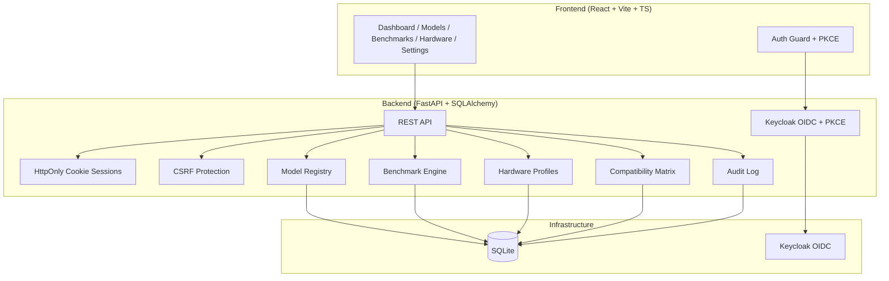

# Tensor Observatory — Alan Vo

> Work in progress. This checkpoint may be incomplete or fail tests. See PLAN.md and STATUS.md before use.


**Alan Vo | AI & Machine Learning** — alanvo@gmail.com

---

Tensor Observatory is a high-throughput and memory-efficient inference and serving engine observability platform for LLMs. It provides model registry, benchmark execution, hardware profiling, and compatibility tracking — all with reproducible, deterministic workflows.

## The Problem

ML engineers deploying LLMs face a fragmented landscape: model architectures (DeepSeek, Llama, Qwen), quantization schemes (FP8, BF16, INT4, NVFP4), and hardware generations (Ampere, Hopper, Blackwell) combine into a combinatorial explosion of configurations. Existing tools either benchmark in isolation, lack hardware-aware compatibility tracking, or require vendor-specific infrastructure.

## The Approach

Tensor Observatory addresses this with:

- **Model Registry** — Centralized metadata for model architecture, quantization, hardware targets, and HuggingFace Hub import
- **Deterministic Benchmark Engine** — Synthetic workloads measuring token throughput, TTFT, TPOT, and memory without requiring LLM API keys
- **Hardware Profiling** — GPU detection (SM version, VRAM, driver/CUDA) and kernel compatibility matrices
- **Compatibility Tracking** — Model-hardware pair status (compatible, partial, untested) with audit logging
- **Opt-in LLM Advisory** — Configurable provider adapters (OpenAI-compatible, Anthropic, Gemini, Ollama) for explanatory analysis, clearly labeled as advisory

All core workflows work offline with zero external dependencies.

---

## Architecture



---

## Quick Start

### Prerequisites

- Docker 24+ and Docker Compose 2+
- Or: Python 3.12, Node 24, Keycloak 25+

### Using Docker Compose (Recommended)

```bash
# Clone and enter directory
cd tensor-observatory-alan-vo

# Copy environment template
cp .env.example .env
# Edit .env with your Keycloak client secret and session keys

# Start all services
docker compose up -d

# Services available at:
# Frontend: http://localhost:5173
# Backend API: http://localhost:8000
# Keycloak Admin: http://localhost:8080 (admin/admin)
```

### Local Development

**Backend:**
```bash
cd backend
python -m venv .venv
source .venv/bin/activate
pip install -r requirements.txt
# Set environment variables (see .env.example)
uvicorn app.main:app --reload --host 127.0.0.1 --port 8000
```

**Frontend:**
```bash
cd frontend
npm install
npm run dev
```

---

## Keycloak Setup

1. Access Keycloak Admin Console at `http://localhost:8080` (admin/admin)
2. Realm `tensor-observatory` is pre-imported with:
   - Client: `tensor-observatory-backend` (confidential, PKCE required)
   - Roles: `viewer`, `operator`, `admin`
   - Redirect URIs: `http://localhost:8000/auth/callback`, `http://localhost:5173/*`
3. Create users and assign realm/client roles as needed

### SAML Identity Provider Brokering

Keycloak supports upstream SAML IdPs (Okta, Azure AD, etc.) via Identity Brokering:

1. In Keycloak Admin → Identity Providers → Add SAML v2.0
2. Configure IdP metadata/entity ID/SSO URL
3. Map SAML attributes to Keycloak user attributes
4. Enable "First Login Flow" to link/create local accounts

---

## API Reference

### Health
- `GET /api/health` — Service health
- `GET /api/health/db` — Database connectivity
- `GET /api/health/ready` — Readiness probe

### Authentication
- `GET /api/auth/login` — Initiate OIDC login (redirects to Keycloak)
- `GET /api/auth/callback` — OIDC callback (sets session cookies)
- `POST /api/auth/logout` — Logout (clears session, redirects to Keycloak logout)
- `GET /api/auth/me` — Current user info
- `GET /api/auth/csrf` — Get CSRF token

### Models
- `GET /api/models` — List models (pagination, filters: search, architecture, quantization)
- `GET /api/models/{id}` — Get model details
- `POST /api/models` — Create model (operator+)
- `PATCH /api/models/{id}` — Update model (operator+)
- `DELETE /api/models/{id}` — Delete model (admin)
- `POST /api/models/import` — Import from HuggingFace Hub (operator+)

### Benchmarks
- `GET /api/benchmarks` — List benchmarks (pagination, filters: model_id, status)
- `GET /api/benchmarks/{id}` — Get benchmark details + results
- `POST /api/benchmarks` — Create benchmark (operator+)
- `DELETE /api/benchmarks/{id}` — Delete benchmark (admin)

### Hardware
- `GET /api/hardware` — List hardware profiles
- `POST /api/hardware` — Create hardware profile (operator+)

### Compatibility
- `GET /api/compatibility` — List model-hardware compatibility
- `POST /api/compatibility` — Create compatibility record (operator+)

---

## Security

### Authentication Architecture
- **Backend-managed sessions** with HttpOnly, SameSite=Lax cookies
- **PKCE** (RFC 7636) for authorization code flow
- **CSRF protection** via double-submit cookie pattern
- **Role-based access control**: viewer < operator < admin
- **JWT validation**: RS256 signatures, issuer/audience/nonce verification
- **JWKS caching** with 1-hour TTL

### Production Requirements
- Set `APP_ENV=production`
- Provide strong `SESSION_SECRET_KEY` and `CSRF_SECRET_KEY`
- Set `KEYCLOAK_CLIENT_SECRET` from Keycloak client credentials
- Enable `SESSION_COOKIE_SECURE=true` (requires HTTPS)
- Configure TLS reverse proxy (nginx/Traefik/Caddy) with valid certificates
- Disable `DEMO_MODE` (defaults to false)

### Limitations
- SQLite is used for simplicity; production should migrate to PostgreSQL
- Session storage is database-backed; consider Redis for horizontal scaling
- No rate limiting implemented; add at reverse proxy layer
- Audit logs stored locally; integrate with SIEM for production

---

## LLM Provider Configuration

| Provider | Env Var | Default | Notes |
|----------|---------|---------|-------|
| OpenAI-compatible | `LLM_API_KEY` | — | Includes LiteLLM, OpenRouter, Ollama, vLLM OpenAI server |
| Anthropic | `LLM_API_KEY` | — | Uses `anthropic` SDK format |
| Gemini | `LLM_API_KEY` | — | Uses `generateContent` endpoint |
| Ollama | `LLM_BASE_URL` | `http://localhost:11434` | Local only, no API key needed |

Additional settings:
- `LLM_PROVIDER` — `openai-compatible` | `anthropic` | `gemini` | `ollama`
- `LLM_MODEL` — Model identifier for the provider
- `LLM_TIMEOUT_SECONDS` — Request timeout (default 30)

All LLM outputs are clearly marked **advisory** and grounded in actual benchmark/hardware records.

---

## AI/ML Evaluation

Tensor Observatory includes a **deterministic benchmark engine** for reproducible inference measurements:

```bash
# Run synthetic benchmark (no LLM key required)
curl -X POST http://localhost:8000/api/benchmarks \
  -H "Content-Type: application/json" \
  -d '{
    "model_id": 1,
    "name": "synthetic-throughput",
    "workload_type": "synthetic",
    "config_json": "{\"batch_size\": 8, \"seq_len\": 2048, \"num_steps\": 100}"
  }'
```

**Metrics collected:**
- Token throughput (tokens/sec)
- Time to First Token (TTFT)
- Time Per Output Token (TPOT)
- Peak GPU memory allocated

**Reproducibility:** Synthetic workloads use fixed random seeds and deterministic tensor operations. No network calls or external model weights required.

**Failure cases documented:**
- Benchmarks fail gracefully with error messages in `error_message` field
- OOM conditions captured and reported
- Invalid configurations rejected at API validation layer

---

## Configuration

### Environment Variables (.env)

```bash
# App
APP_ENV=development          # development | production | demo
DEBUG=true
HOST=127.0.0.1
PORT=8000

# Database
DATABASE_URL=sqlite+aiosqlite:///./data/tensor_observatory.db

# Keycloak
KEYCLOAK_SERVER_URL=http://localhost:8080
KEYCLOAK_REALM=tensor-observatory
KEYCLOAK_CLIENT_ID=tensor-observatory-backend
KEYCLOAK_CLIENT_SECRET=your-secret-here
KEYCLOAK_REDIRECT_URI=http://localhost:8000/auth/callback

# Session
SESSION_SECRET_KEY=your-32-char-secret
CSRF_SECRET_KEY=your-32-char-secret
SESSION_COOKIE_SECURE=false
SESSION_COOKIE_SAMESITE=lax
SESSION_MAX_AGE_SECONDS=86400

# LLM (optional)
LLM_API_KEY=
LLM_PROVIDER=openai-compatible
LLM_MODEL=
LLM_BASE_URL=
LLM_TIMEOUT_SECONDS=30

# Demo mode (never enable in production!)
DEMO_MODE=false
DEMO_USER_EMAIL=demo@tensor-observatory.local
DEMO_USER_NAME=Demo User
```

---

## Backup & Restore

### Database Backup
```bash
# SQLite backup (online)
sqlite3 data/tensor_observatory.db ".backup backup_$(date +%F).db"

# Or copy the file (requires brief downtime)
cp data/tensor_observatory.db backup_$(date +%F).db
```

### Keycloak Backup
```bash
# Export realm
docker exec tensor-observatory-keycloak \
  /opt/keycloak/bin/kc.sh export --dir /opt/keycloak/data/export --realm tensor-observatory
```

---

## Development

### Running Tests

```bash
# Backend
cd backend
.venv/bin/python -m pytest tests/ -v

# Frontend
cd frontend
npm test
```

### Code Quality

```bash
# Backend type checking
cd backend
.venv/bin/mypy app/

# Frontend type checking + build
cd frontend
npm run build
```

---

## Deployment Notes

### TLS Reverse Proxy (nginx example)

```nginx
server {
    listen 443 ssl http2;
    server_name your-domain.com;

    ssl_certificate /path/to/cert.pem;
    ssl_certificate_key /path/to/key.pem;

    location / {
        proxy_pass http://127.0.0.1:5173;
        proxy_set_header Host $host;
        proxy_set_header X-Real-IP $remote_addr;
        proxy_set_header X-Forwarded-For $proxy_add_x_forwarded_for;
        proxy_set_header X-Forwarded-Proto $scheme;
    }

    location /api/ {
        proxy_pass http://127.0.0.1:8000;
        proxy_set_header Host $host;
        proxy_set_header X-Real-IP $remote_addr;
        proxy_set_header X-Forwarded-For $proxy_add_x_forwarded_for;
        proxy_set_header X-Forwarded-Proto $scheme;
    }

    location /auth/callback {
        proxy_pass http://127.0.0.1:8000;
        proxy_set_header Host $host;
        proxy_set_header X-Real-IP $remote_addr;
        proxy_set_header X-Forwarded-For $proxy_add_x_forwarded_for;
        proxy_set_header X-Forwarded-Proto $scheme;
    }
}
```

### Keycloak Production
- Use external PostgreSQL database (`KC_DB=postgres`)
- Configure `KC_HOSTNAME` with your domain
- Enable `KC_HTTPS_PORT=443` and `KC_PROXY=edge`
- Store admin credentials in secrets manager

---

## License

MIT License — Copyright (c) 2024 Alan Vo <alanvo@gmail.com>

See [LICENSE](LICENSE) for details.